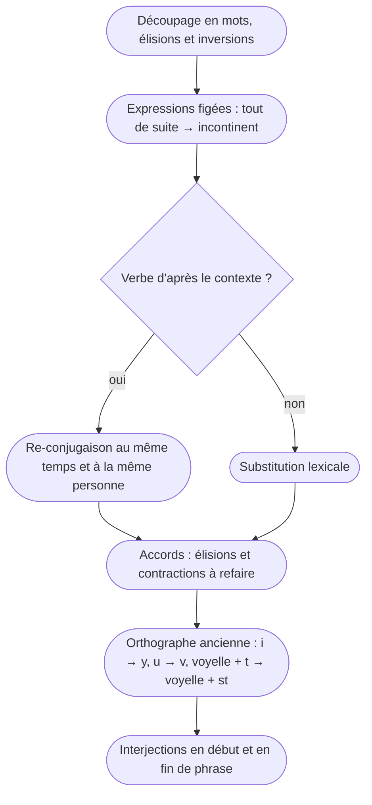

Transforme une phrase en français moderne en vieux français façon **Les Visiteurs** : ni académique, ni exact, entièrement drolatique.

Le moteur n'a aucune dépendance. Il s'utilise comme bibliothèque Python, en ligne de commande depuis n'importe quel langage, ou par la page web.

## Exemples

Sorties réelles au niveau par défaut, reproductibles avec la `seed` indiquée :

| Moderne | Seed | Archaïque |
| --- | --- | --- |
| Elle chantait une belle chanson | 1 | Elle entonnoist vne belle ristournelle |
| Il ne buvait pas assez d'eau | 5 | Il ne chopinoist poynt prov d'eav |
| Je cherchais mon portable | 2 | Ie gvettoys mon parchemin volant |
| Madame, vous êtes très belle | 4 | Corbleu ! dame, vous estez fort belle |
| Je mange une pomme dans le jardin | 3 | Par saint Gilles ! je ripailloy vne pomme en le iardin, maraud |

## Utilisation

### Bibliothèque Python

```bash
pip install "git+https://github.com/XNinety9/vetuste_scripteur"
```

```python
from vetuste_scripteur import translate

translate("Je mange une pomme")           # une version au hasard
translate("Je mange une pomme", seed=42)  # toujours la même
translate("Je mange une pomme", level=3)  # façon grimoire illisible
```

| `level` | Effet |
| --- | --- |
| 0 | Vocabulaire et grammaire seuls, sans orthographe ancienne ni interjections |
| 1 | Léger accent |
| 2 | Les Visiteurs (par défaut) |
| 3 | Grimoire illisible |

### Ligne de commande

```bash
vetuste-scripteur "Je mange une pomme"
vetuste-scripteur --niveau 3 --seed 42 "Je mange une pomme"
echo "Je mange une pomme" | vetuste-scripteur
vetuste-scripteur             # quelques exemples
```

### Depuis un autre programme

`--json` donne une sortie stable, à lire depuis n'importe quel langage. Sans `--seed`, la seed tirée est renvoyée pour pouvoir rejouer le résultat.

```console
$ vetuste-scripteur --json --seed 4 "Madame, vous êtes très belle"
{"original": "Madame, vous êtes très belle", "result": "Corbleu ! dame, vous estez fort belle", "seed": 4, "level": 2, "version": "1.1.1"}
```

Pour ne rien installer, `scripts/construire_pyz.py` produit `dist/vetuste-scripteur.pyz` : tout le moteur et l'enluminure en un seul fichier d'environ 160 Ko, qui demande seulement Python 3.11 ou plus. Il fonctionne aussi sous systemd, en locale `C`.

```bash
python3 vetuste-scripteur.pyz --json "Je mange une pomme"
```

Pour obtenir le même résultat toute une journée, il suffit de dériver la `seed` de la date. Le texte peut aussi passer par l'entrée standard (`-`) plutôt que par les arguments.

### Enluminure

Le texte transmogrifié, dessiné comme une page de manuscrit : lettrine dorée, frise de lierre et rubriques. Le résultat est un document SVG autonome, sans fonte à installer ni ressource à télécharger. Là aussi, il n'y a aucune dépendance.

```python
from vetuste_scripteur import enluminure

svg = enluminure("Je mange une pomme", seed=42, level=2, largeur=1200)
```

```bash
vetuste-scripteur --svg --seed 42 "Je mange une pomme" > page.svg
```

Le même dessin revient pour une même phrase avec les mêmes `seed`, `level` et `largeur`.

Pour obtenir un PNG, n'importe quel outil qui lit le SVG convient. La bibliothèque standard de Python ne sait pas le faire :

```bash
vetuste-scripteur --svg "Je mange une pomme" | rsvg-convert -o page.png
```

Les caractères absents de la fonte gothique (emojis, idéogrammes) laissent un blanc. Le français est entièrement couvert.

### Gravure pour imprimante thermique

Le texte seul en gothique, sans décor, dans un PNG noir et blanc de la largeur demandée. L'image est en 1 bit, sans gris à tramer, et là non plus il n'y a aucune dépendance. La largeur est obligatoire.

```python
from vetuste_scripteur import gravure

png = gravure("Je mange une pomme", largeur=512, seed=42)
```

```bash
vetuste-scripteur --png --largeur 512 --seed 42 "Je mange une pomme" > ticket.png
```

La taille du texte suit la largeur : 36 px sur 512 px, soit environ 4,5 mm sur un ticket de 80 mm à 203 dpi. La hauteur ne dépasse pas 10 000 px : le texte rétrécit si besoin.

Pour l'intégrer à Printr, tout est dans [integration/printr/](integration/printr/README.md). À la main, utiliser une largeur de 512 px et imprimer sans tramage :

```bash
printr image --dither none ticket.png
```

### Page web et API

```bash
pip install "vetuste-scripteur[web] @ git+https://github.com/XNinety9/vetuste_scripteur"
uvicorn vetuste_scripteur.web:app
```

- Interface : [http://127.0.0.1:8000](http://127.0.0.1:8000), avec le niveau de vétusté, un nouveau tirage, un lien de partage qui rejoue le même résultat, l'enregistrement du parchemin en image et l'option Enluminure
- Endpoint JSON : `GET /translate?phrase=...&seed=...&level=...` (5 000 caractères au plus)
- Enluminure : `GET /enluminure.svg?phrase=...&seed=...&level=...&largeur=...`. Sans `seed`, celle qui a été tirée se trouve dans l'en-tête `X-Seed`
- Gravure : `GET /enluminure.png?phrase=...&largeur=...&seed=...&level=...`, avec le même en-tête
- Schéma de l'API : [http://127.0.0.1:8000/openapi.json](http://127.0.0.1:8000/openapi.json)

La page fonctionne sans connexion à Internet : ses fontes sont incluses dans le paquet.

## Fonctionnement



### Reconnaître un verbe sans modèle de langue

Le contexte proche suffit à trancher la plupart des cas, et c'est plus fiable que `fr_core_news_sm` sur des phrases courtes :

- un pronom sujet fixe la personne : `vous courez` est un présent, pas un futur en `-rez` ;
- un déterminant annonce un nom : `la porte` n'est pas `il porte` ;
- une préposition n'admet que l'infinitif ou le gérondif : `pour manger`, `en mangeant` ;
- un auxiliaire annonce un participe : `il a fait`, `il est mort` ;
- sans pronom, un groupe de mots n'a qu'un verbe conjugué : dans `la maison est vide`, `vide` est un adjectif.

Les limites sont celles d'un outil de règles : un nom inconnu ou une tournure rare peuvent être mal classés. Le résultat reste drolatique.

### Les règles

1. **Lexique** : environ 320 formes remplacées, pluriels et féminins compris (`monsieur` → `messire`, `voiture` → `carriole`, `portable` → `parchemin volant`…). Un substitut garde le genre du mot d'origine, pour que l'article et les adjectifs restent justes.
2. **Verbes** : 42 verbes remplacés et re-conjugués à tous les temps simples (`manger` → `ripailler`, `boire` → `chopiner`…), et environ 400 verbes reconnus.
3. **Finales anciennes** : imparfait et conditionnel en `-ois`, `-oit`, `-oient`, présent en `-oy`, verbe être archaïque (`estoy`, `estez`, `estoient`…).
4. **Accords** : `l'ami` → `le compagnon`, `de l'argent` → `du denier`, `je chante` → `j'entonnoy`, `ma peur` → `mon épouvante`.
5. **Orthographe** : `i` → `y`, `u` → `v`, `j` → `i`, `s` intervocalique → `z`, et `s` caduc (`été` → `esté`, `ritournelle` → `ristournelle`).
6. **Interjections** : *Corbleu !*, *Passepoil !*, *Fientrecul !* en début de phrase, et apostrophes en fin de phrase (*…, maraud*).

## Développement

```bash
uv sync --extra web
uv run pytest
```

- `vetuste_scripteur/lexique.py` contient les mots et les verbes à remplacer.
- `vetuste_scripteur/glyphes.json` est généré à partir de la fonte gothique par `uv run scripts/generer_glyphes.py`.
- `vetuste_scripteur/verbes.json` est généré : après avoir modifié la liste des verbes, lance `uv run scripts/generer_verbes.py`. verbecc n'est nécessaire qu'à cette étape.

## Ressources

- [verbecc](https://github.com/bretttolbert/verbecc) : source des conjugaisons de `verbes.json`
- [FastAPI](https://fastapi.tiangolo.com/) : API et interface web
- Fontes, sous licence SIL Open Font License : [UnifrakturMaguntia](https://fonts.google.com/specimen/UnifrakturMaguntia) et [Crimson Text](https://fonts.google.com/specimen/Crimson+Text), fichiers d'origine et licences dans `vetuste_scripteur/fonts/`
- [Dictionnaire français médiéval](http://buze.michel.chez.com/lavache/dictionnaire_francais_medieval_moyen_age.htm)

## Licence

Apache 2.0 (fichier [LICENSE](LICENSE)). Les fontes et les données de conjugaison ont leurs propres licences, détaillées dans [NOTICE](NOTICE).
